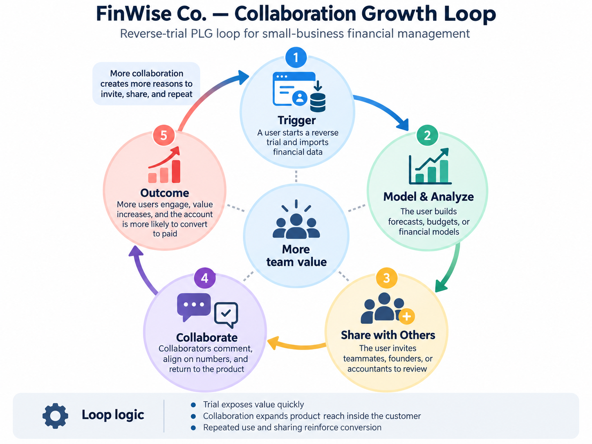

# The Bet · FinWise

> Module 1 · Ignite a PLG Motion. The growth hypothesis and where you're betting, plus the growth-loop visualization.

## Growth hypothesis

FinWise's biggest growth problem is Users are not seeing the value the product is offering to finally become a paid user, because the users are starting from different features and collaboration can expand product reach.

_Working notes: I think FinWise’s biggest problem is Activation - Users do not see the value of the product as only 2% of customers convert from trial to paid. Evidence: Users do not see the value of the product as only 2% of customers convert from trial to paid.
As most of the marketing budget is going to Acquisition the understanding of why they are not getting value is crucial. Against the data: Massive drop-off from Trial to Paid (98.01%)
- Only 128 out of 6,424 trials converted to paid.
- Trial-to-Paid conversion averaged 1.99% across the 13 months.
- The drop-off remained consistently high, between 97.92% and 98.13% each month._

_____

## The bet

make a share option with teamates to collaborate and share the value they get with the product

**Not doing:** 1. Acquisition experiments from the Acquisition> Trial until we normalized how users can get value first. 
2. New revenue stream experiments

_____

## Growth loop

**Loop type:** Collaboration, I would experiment with a collaboration loop that helps users experience the product’s value as a team. By seeing what other team members are discovering and working on, users can better understand the benefits of collaborating within the platform. During the reverse trial, this shared experience could reinforce the product’s value and ultimately drive a collective decision to upgrade to a paid plan.

_____
