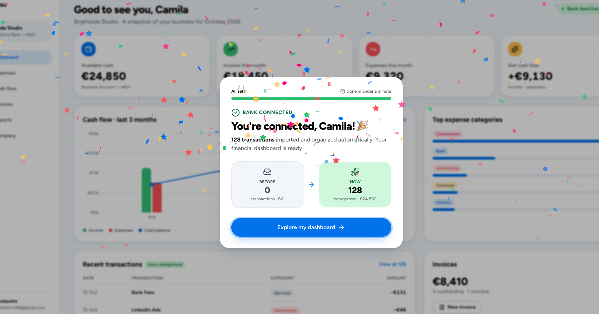

# The Solution · FinWise

> Module 2 · Acquisition & Activation. The onboarding solution and the Aha moment that makes value land.

## Aha moment

Connecting a live bank feed: Seeing hundreds of financial transactions automatically appear, get organized, and categorized within seconds.

_____

## Onboarding prototype

[Prototype link](https://trueframe-ui-capture.lovable.app/)

_____

## Why this activates

connecting a live bank feed as FinWise's hypothesized Aha Moment because it delivers the product's core value: eliminating manual financial data entry. More importantly, it establishes an ongoing financial workflow through automatically synchronized transactions, giving users a reason to return. To validate this as an activation signal, I would compare retention and Trial-to-Paid conversion between users who successfully import transactions and those who don't. Link: [Prototype link](https://trueframe-ui-capture.lovable.app/)

_____
