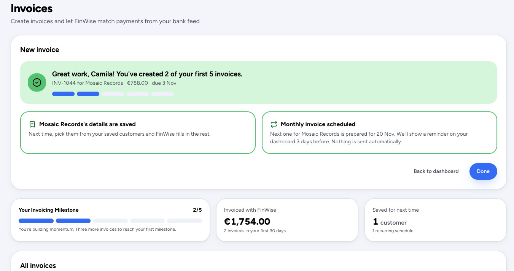
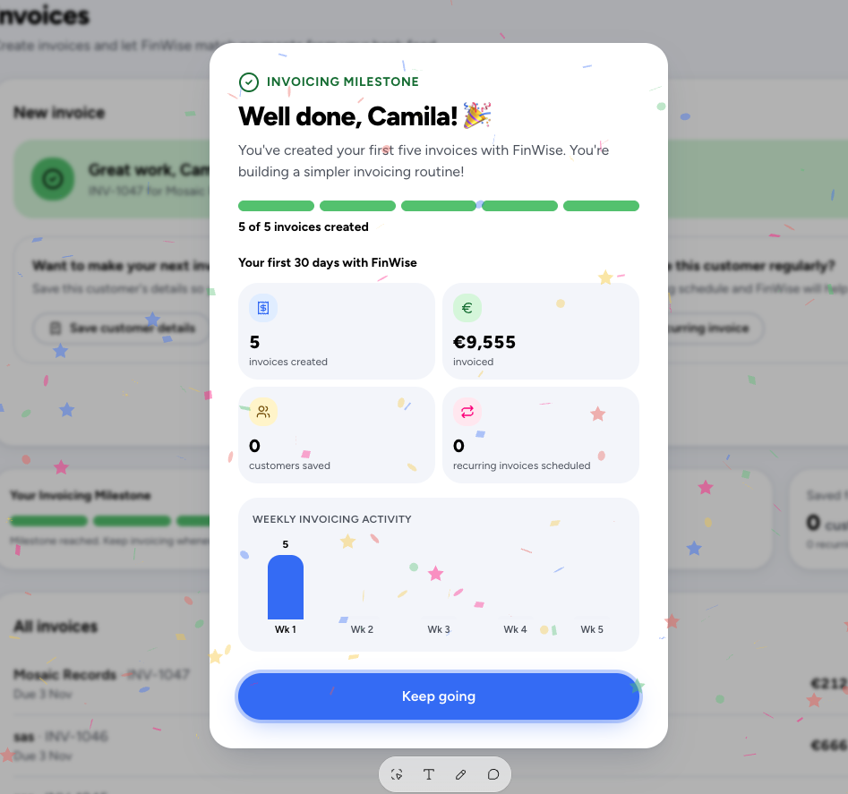

# The Mechanic · FinWise

> Module 3 · Retention & Engagement. The engagement mechanic that builds the habit loop, with rationale and a wireframe.

## The mechanic

**Mechanic:** Progress Bar

- **Trigger:** When the user reaches their usual invoicing period, FinWise displays a gentle reminder based on their previous activity to encourage repeat usage.
- **Action:** User creates 5+ invoices within the first 30 days
- **Reward:** A consistency milestone, a small celebration, and a personalized weekly summary showing invoices created and total amount invoiced.
- **Investment:** User saves customer information and schedules their next recurring invoice.

_____

## Rationale

For FinWise, users might not know how to create invoices or realize how much time they could save by automating them. So, this is also an educational trigger so the action can be a recurring task if they know how to use it. 

I chose a progress bar tied to creating five invoices within the first 30 days because this behavior has been identified as predictive of retention.

The mechanic combines educational triggers to teach users how to invoice, visible progress to encourage repeated usage, and meaningful rewards that reinforce business value.

By saving customer details and scheduling recurring invoices, users invest in FinWise, making future actions easier and creating contextual reasons to return.

_____

## Wireframe

[Wireframe link](https://trueframe-ui-capture.lovable.app/)

_____
